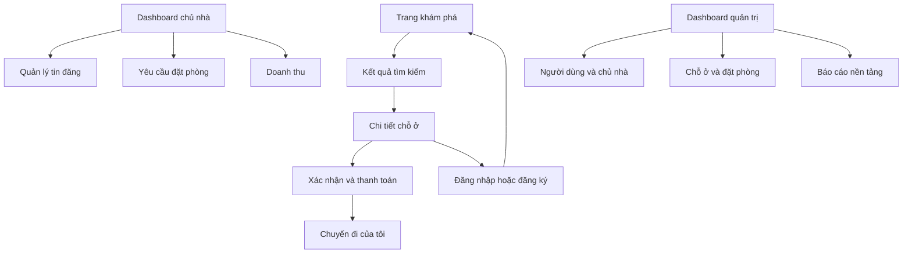
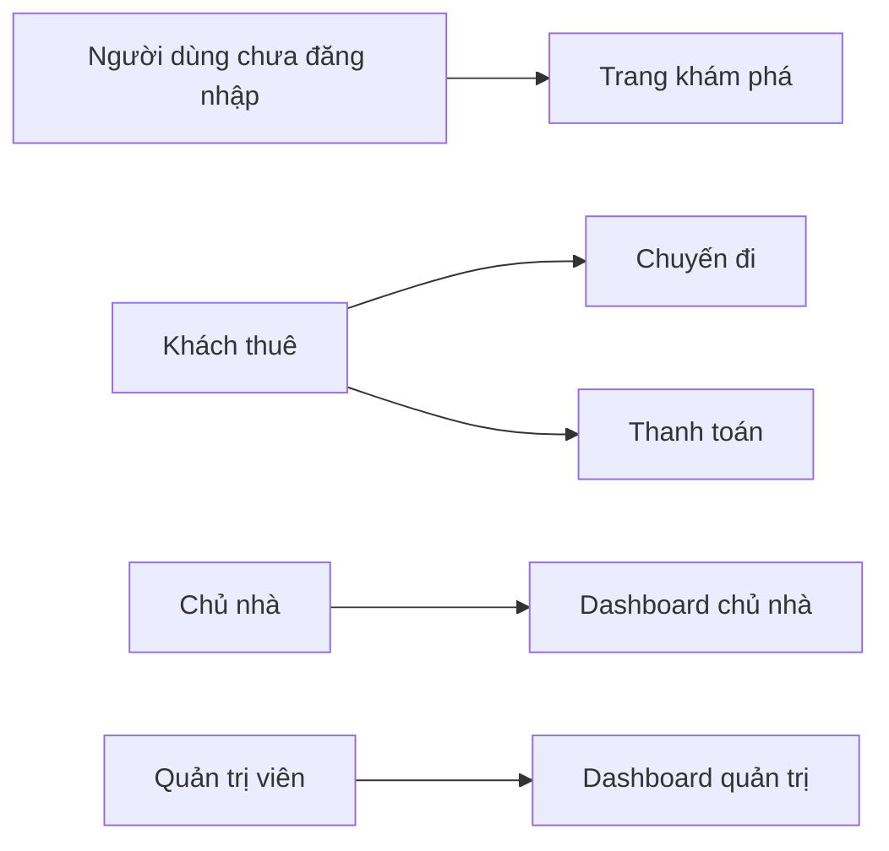
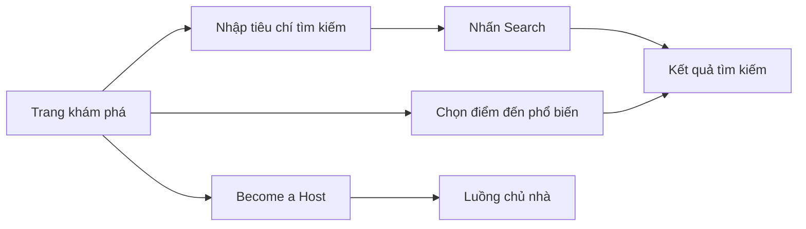
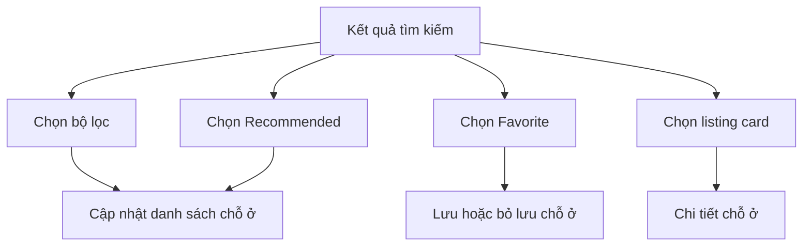
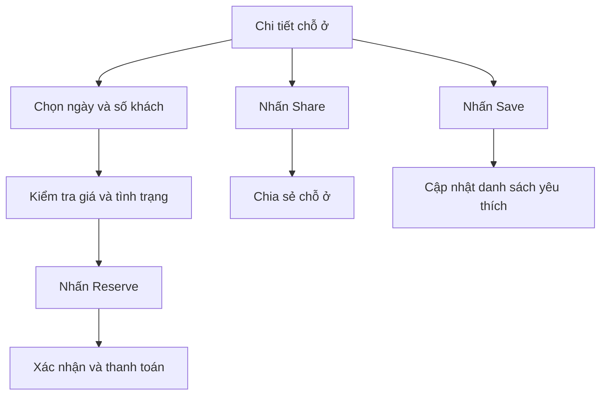
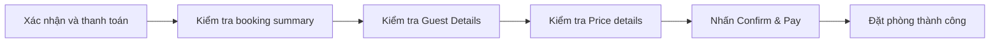
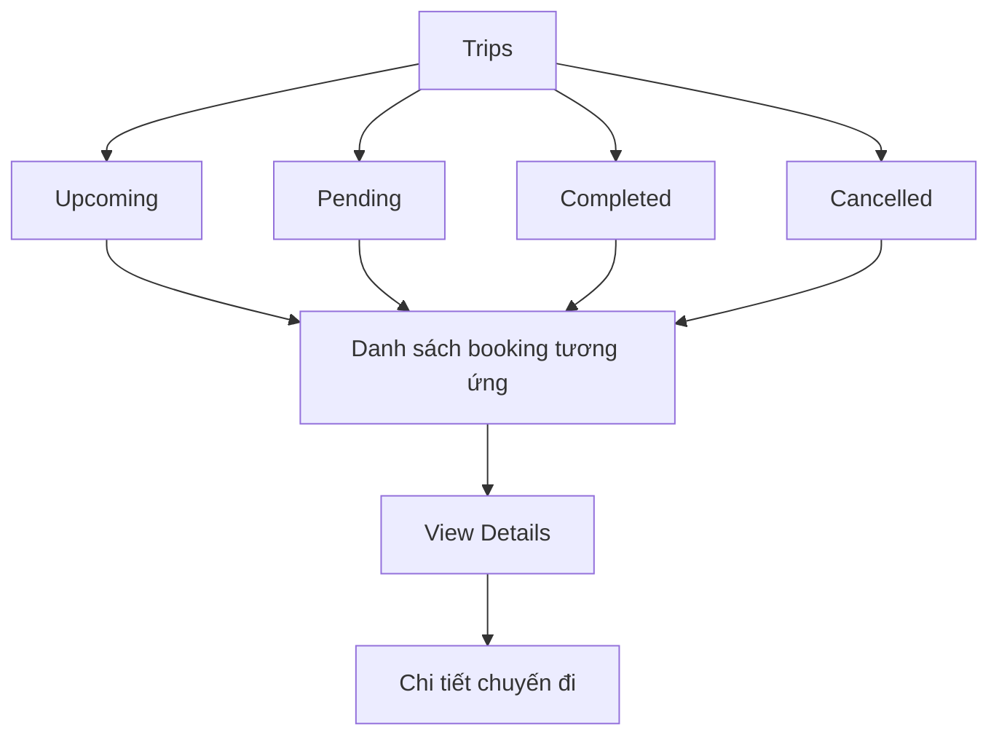
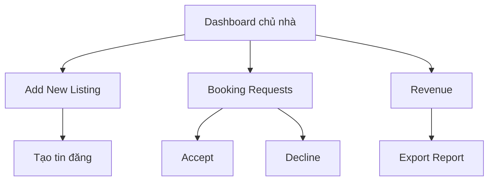
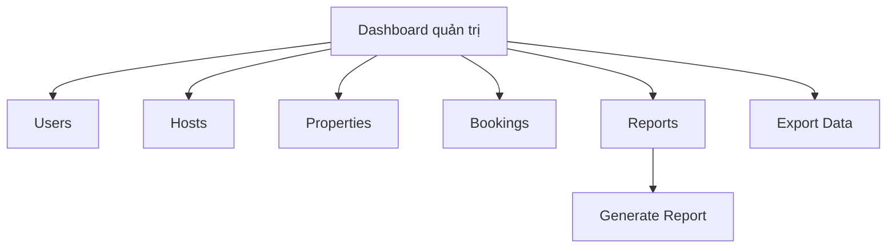

# CHƯƠNG 5: THIẾT KẾ GIAO DIỆN

## 5.1. Phạm vi và nguyên tắc thiết kế

Mô tả hệ thống giao diện website StayHub. Hệ thống phục vụ ba nhóm người dùng chính:

- Khách thuê: tìm kiếm chỗ ở, xem thông tin chỗ ở, quản lý chuyến đi và thanh toán đặt phòng.
- Chủ nhà: quản lý tin đăng, yêu cầu đặt phòng, tin nhắn và doanh thu.
- Quản trị viên: theo dõi người dùng, chủ nhà, chỗ ở, đơn đặt phòng và báo cáo toàn nền tảng.

Giao diện sử dụng bố cục responsive, tương thích với màn hình máy tính bảng và máy tính để bàn. Trên màn hình nhỏ, thanh điều hướng ngang hoặc thanh bên được thu gọn thành nút menu.

## 5.2. Danh sách các màn hình và sơ đồ chuyển đổi

### 5.2.1. Danh sách màn hình

| STT | Màn hình | Vai trò sử dụng | Mục đích chính |
|:--:|:--:|:--:|:--:|
| 1 | Trang chủ | Khách thuê | Tìm kiếm và khám phá điểm đến |
| 2 | Kết quả tìm kiếm | Khách thuê | Lọc và chọn chỗ ở phù hợp |
| 3 | Chi tiết chỗ ở | Khách thuê | Xem ảnh, tiện nghi, đánh giá và đặt phòng |
| 4 | Xác nhận và thanh toán | Khách thuê | Kiểm tra thông tin khách và thanh toán |
| 5 | Chuyến đi của tôi | Khách thuê | Theo dõi các lượt đặt phòng |
| 6 | Dashboard chủ nhà | Chủ nhà | Quản lý tin đăng và yêu cầu đặt phòng |
| 7 | Dashboard quản trị | Quản trị viên | Theo dõi chỉ số và hoạt động nền tảng |

### 5.2.2. Sơ đồ chuyển đổi tổng quát

### 5.2.3. Quyền truy cập theo vai trò

## 5.3. Mô tả chi tiết các màn hình

### 5.3.1. Màn hình trang chủ

**Ý nghĩa:** Cho phép khách thuê bắt đầu hành trình tìm kiếm chỗ ở, trải nghiệm và dịch vụ tại các điểm đến phổ biến.

**Bố cục giao diện:** Thanh điều hướng cố định ở đầu trang, khu vực hero có ảnh nền và tiêu đề, thanh tìm kiếm dạng pill, danh sách điểm đến phổ biến, chân trang chứa các liên kết thông tin.

| STT | Thành phần | Ý nghĩa |
|:--:|---|---|
| 1 | Logo và biểu tượng Explore | Nhận diện thương hiệu và quay về trang chủ |
| 2 | Liên kết Stays, Experiences, Services | Chuyển đổi nhóm nội dung |
| 3 | Become a Host | Mở luồng dành cho chủ nhà |
| 4 | Thanh tìm kiếm | Nhập địa điểm, ngày nhận/trả phòng và số khách |
| 5 | Nút Search | Thực hiện tìm kiếm |
| 6 | Danh sách Popular Destinations | Chọn nhanh Hồ Chí Minh, Đà Nẵng, Đà Lạt, Nha Trang hoặc Hà Nội |
| 7 | Footer links | Privacy, Terms, Sitemap, Company Details và Destinations |

**Sơ đồ biến cố:**

### 5.3.2. Màn hình kết quả tìm kiếm

**Ý nghĩa:** Hiển thị danh sách chỗ ở phù hợp với tiêu chí tìm kiếm tại một địa điểm, ví dụ “120 stays in Da Nang”.

| STT | Thành phần | Ý nghĩa |
|:--:|---|---|
| 1 | Header StayHub | Điều hướng về trang chính và các khu vực Explore, Trips, Wishlists |
| 2 | Search summary | Hiển thị địa điểm, thời gian và số khách hiện tại |
| 3 | Bộ lọc Price | Lọc theo khoảng giá |
| 4 | Bộ lọc Property type | Lọc theo loại hình chỗ ở |
| 5 | Bộ lọc Amenities | Lọc theo tiện nghi |
| 6 | Bộ sắp xếp Recommended | Sắp xếp kết quả |
| 7 | Listing card | Hiển thị ảnh, tên, vị trí, điểm đánh giá và giá |
| 8 | Nút Favorite | Lưu chỗ ở vào danh sách yêu thích |

**Sơ đồ biến cố:**

### 5.3.3. Màn hình chi tiết chỗ ở

**Ý nghĩa:** Cung cấp đầy đủ thông tin trước khi khách thuê quyết định đặt phòng.

**Bố cục giao diện:** Header có thanh tìm kiếm; tiêu đề, đánh giá và địa chỉ; gallery năm ảnh; phần thông tin chủ nhà và tiện nghi; mô tả; thẻ đặt phòng cố định ở cột bên phải.

| STT | Thành phần | Ý nghĩa |
|:--:|---|---|
| 1 | Search bar | Tìm lại địa điểm, thời gian hoặc số khách |
| 2 | Tiêu đề và metadata | Hiển thị tên chỗ ở, điểm đánh giá, số review, Superhost và địa chỉ |
| 3 | Nút Share | Chia sẻ đường dẫn chỗ ở |
| 4 | Nút Save | Lưu chỗ ở vào danh sách yêu thích |
| 5 | Gallery ảnh | Hiển thị phòng khách, bếp, phòng ngủ, phòng tắm và ban công |
| 6 | Thông tin host | Hiển thị chủ nhà và sức chứa |
| 7 | Danh sách tiện nghi nổi bật | Workspace, hồ bơi và trải nghiệm nhận phòng |
| 8 | About this place | Mô tả chi tiết chỗ ở |
| 9 | Booking card | Chọn ngày, số khách và chuyển sang đặt phòng |
| 10 | Reserve | Bắt đầu luồng xác nhận và thanh toán |

**Sơ đồ biến cố:**

### 5.3.4. Màn hình xác nhận và thanh toán

**Ý nghĩa:** Cho phép khách kiểm tra lại thông tin đặt phòng, thông tin cá nhân và tổng chi phí trước khi xác nhận.

| STT | Thành phần | Ý nghĩa |
|:--:|---|---|
| 1 | Header StayHub | Nhận diện và điều hướng |
| 2 | Booking summary | Hiển thị chỗ ở, ngày nhận/trả phòng, số khách và đánh giá |
| 3 | Guest Details | Hiển thị họ tên, email và số điện thoại khách |
| 4 | Price details | Phân tách giá phòng, phí dịch vụ và tổng tiền |
| 5 | Payment area | Khu vực thực hiện thanh toán |
| 6 | Confirm & Pay | Xác nhận giao dịch đặt phòng |

**Sơ đồ biến cố:**

### 5.3.5. Màn hình chuyến đi của tôi

**Ý nghĩa:** Cho phép khách thuê theo dõi các lượt đặt phòng theo trạng thái.

| STT | Thành phần | Ý nghĩa |
|:--:|---|---|
| 1 | Navigation bar | Điều hướng Explore, Trips và Wishlists |
| 2 | Host your home | Chuyển sang luồng dành cho chủ nhà |
| 3 | Tabs Upcoming, Pending, Completed, Cancelled | Lọc các lượt đặt phòng theo trạng thái |
| 4 | Booking card | Hiển thị ảnh, tên chỗ ở, vị trí và trạng thái |
| 5 | Check-in và Check-out | Hiển thị thời gian lưu trú |
| 6 | Total Price | Hiển thị tổng giá trị chuyến đi |
| 7 | View Details | Mở thông tin chi tiết lượt đặt phòng |

**Sơ đồ biến cố:**

### 5.3.6. Màn hình dashboard chủ nhà

**Ý nghĩa:** Cung cấp trung tâm điều hành cho chủ nhà quản lý các tin đăng và hoạt động kinh doanh.

**Bố cục giao diện:** Sidebar cố định ở bên trái; nội dung dashboard ở bên phải; trên màn hình nhỏ sidebar được thay bằng nút menu.

| STT | Thành phần | Ý nghĩa |
|:--:|---|---|
| 1 | Host profile | Hiển thị tên và vai trò chủ nhà |
| 2 | Add New Listing | Tạo tin đăng mới |
| 3 | My Properties | Quản lý danh sách chỗ ở |
| 4 | Booking Requests | Xử lý yêu cầu đặt phòng |
| 5 | Messages | Theo dõi tin nhắn |
| 6 | Revenue | Theo dõi doanh thu |
| 7 | KPI cards | Tổng properties, booking chờ duyệt, booking đã xác nhận và doanh thu tháng |
| 8 | Recent Booking Requests | Hiển thị yêu cầu gần đây |
| 9 | Accept / Decline | Chấp nhận hoặc từ chối yêu cầu |
| 10 | Export Report | Xuất báo cáo |

**Sơ đồ biến cố:**

### 5.3.7. Màn hình dashboard quản trị

**Tệp giao diện:** `code.html`

**Ý nghĩa:** Giúp quản trị viên theo dõi tổng quan hoạt động của nền tảng StayHub.

| STT | Thành phần | Ý nghĩa |
|:--:|---|---|
| 1 | Sidebar quản trị | Điều hướng Dashboard, Users, Hosts, Properties, Bookings, Reports và Settings |
| 2 | Admin profile | Hiển thị người dùng quản trị và quyền Super Admin |
| 3 | Platform Overview | Tiêu đề và mô tả khu vực tổng quan |
| 4 | Export Data | Xuất dữ liệu nền tảng |
| 5 | Generate Report | Tạo báo cáo |
| 6 | KPI cards | Total Users, Active Hosts, Platform Revenue và Total Bookings |
| 7 | Recent Bookings | Theo dõi các booking gần đây |
| 8 | Pagination | Chuyển trang danh sách booking |

**Sơ đồ biến cố:**

## 5.4. Đặc tả phong cách giao diện

### 5.4.1. Màu sắc và trạng thái

Giao diện dùng nền sáng, nhiều khoảng trắng và màu nhấn xanh lam/tím nhạt của StayHub. Các thẻ nội dung dùng nền trắng hoặc `surface-container-lowest`, đường viền xám nhạt và bo góc lớn. Trạng thái thành công dùng xanh lá; trạng thái chờ xử lý dùng màu nhấn; trạng thái phụ dùng nền xám nhạt.

| Nhóm | Quy ước sử dụng |
|---|---|
| Primary | Logo, liên kết đang chọn, nút hành động chính |
| Surface | Nền trang và vùng nội dung |
| Surface container | Thanh điều hướng, footer, vùng phụ trợ |
| Outline | Viền thẻ, input, tab và thanh tìm kiếm |
| Success | Booking đã xác nhận, tăng trưởng và thao tác Accept |

### 5.4.2. Typography và biểu tượng

- Font chính là Inter hoặc font sans-serif tương đương.
- Tiêu đề dùng cấp display/headline lớn, thân thiện và dễ quét.
- Nội dung mô tả dùng body text với màu phụ để tạo phân cấp thị giác.
- Biểu tượng sử dụng Material Symbols, đặt cạnh nhãn khi cần tăng khả năng nhận biết.

### 5.4.3. Responsive và khả năng sử dụng

- Sidebar dashboard hiển thị từ breakpoint lớn; màn hình nhỏ sử dụng nút menu.
- Grid kết quả tìm kiếm chuyển từ nhiều cột sang một cột.
- Gallery ảnh chi tiết chỗ ở chuyển thành một cột trên thiết bị nhỏ.
- Các nút hành động chính có kích thước đủ lớn, nhãn rõ ràng và trạng thái hover/active.
- Các thẻ booking và listing ưu tiên ảnh, tiêu đề, trạng thái, giá và hành động chính.

## 5.5. Kết luận

Thiết kế giao diện StayHub được tổ chức theo mô hình marketplace gồm luồng khám phá - tìm kiếm - xem chi tiết - thanh toán - theo dõi chuyến đi. Hai dashboard riêng cho chủ nhà và quản trị viên giúp phân tách nhiệm vụ vận hành. Hệ thống sử dụng cùng một ngôn ngữ thị giác: nền sáng, card bo góc, màu nhấn nhất quán, icon trực quan và bố cục responsive.

