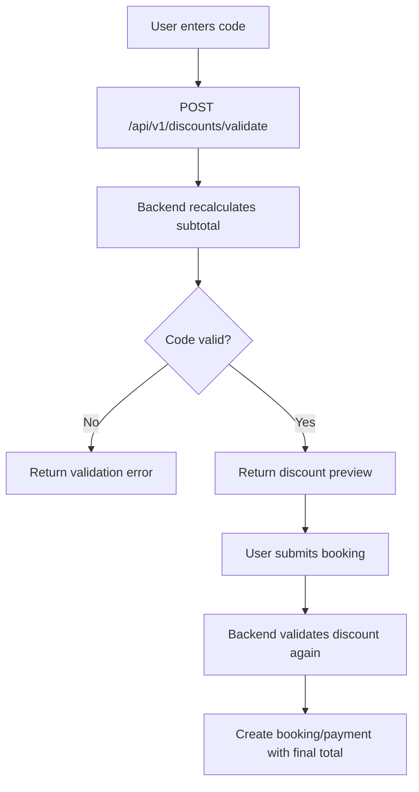

# Discounts

**S0-109-v1 FROZEN_DESIGN:** [typed CampaignPublish/Selection/errors](../business/contracts/s0-api-v1.json), [policy](../business/contracts/s0-policy-v1.json)/[fixtures](../business/contracts/s0-fixtures-v1.json). quota is mandatory positivefinite per-campaign publication input, never a hardcoded livebudget; value/type/timewindow servervalidated. Frozen088controls,089runtimepending, no taxamount/signatures/activation introduced.

**Approved TARGET S0-088-v1, 2026-10-23, not implemented:** [Payment section2b](../business/PaymentBusinessRules.md) canonical: self-owner block, one code/no stacking, per-user/code1 accepted-online consumption; required positive finite campaign Q, no unlimited default. PlatformD<=Cgross, Cnet=Cgross−D/O>=Cnet, no Guest fee. Whole-VND HALF_UP/stable largest remainder, no zeroT/O exception. Tax unset/disabled, paid release blocked.

> **LEGACY schema/formula/flow below, not active contract:** nullable usage_limit/per_user_limit or service_fee do not authorize unlimited quota/stacking/Guest fee. TARGET requires Q>0 finite integer, user cap1, campaign/amount/funder/version snapshots and audited reservation/consumption records; actual additive schema089/099/110 not claimed existing.

Enforce global consumed+activeReserved<=Q and user consumed+activeReserved<=1 under shared locks/uniqueness. Reserve checkout atomically with original15min all-item hold; preview none. Retries reuse, attempt failure retains; accepted online consumes once; guarded booking final-fail/expiry/pre-consumption cancel releases once. CONSUMED not restored on cancellation/refund, direct B/late-extra IPN never unlocks eligibility. Clock-only expiry subtraction forbidden before serialized release. Canonical2b defines400/409 validation/race/rounding/zero semantics; docs are not runtime concurrency proof.

Discounts are applied during booking price calculation and must be revalidated on the backend when creating a payment. The frontend discount preview is only a convenience for the user.

| Column | Type | Constraint | Description |
|---|---|---|---|
| `id` | BIGINT | PK | Discount identifier |
| `code` | VARCHAR(50) | NOT NULL, UNIQUE | Public promo code, stored uppercase |
| `name` | VARCHAR(150) | NOT NULL | Display/internal name |
| `type` | VARCHAR(20) | NOT NULL | `PERCENT`, `FIXED` |
| `value` | NUMERIC(12,2) | NOT NULL | Percentage or fixed amount depending on type |
| `max_discount_amount` | NUMERIC(12,2) | NULL | Cap for percent discounts |
| `min_booking_amount` | NUMERIC(12,2) | NULL | Minimum subtotal required |
| `starts_at` | TIMESTAMPTZ | NULL | Valid from |
| `ends_at` | TIMESTAMPTZ | NULL | Valid until |
| `usage_limit` | INT | NULL | Global usage limit |
| `used_count` | INT | NOT NULL | Successful paid usages |
| `per_user_limit` | INT | NULL | Optional per-user cap |
| `active` | BOOLEAN | NOT NULL | Whether code can be used |
| `created_at` | TIMESTAMPTZ | NOT NULL | Creation timestamp |
| `updated_at` | TIMESTAMPTZ | NOT NULL | Last update timestamp |

## Recommended constraints

```sql
CONSTRAINT chk_discount_type
CHECK (type IN ('PERCENT', 'FIXED'));

CONSTRAINT chk_discount_value_positive
CHECK (value > 0);

CONSTRAINT chk_discount_used_count
CHECK (used_count >= 0);
```

## Calculation rules

```text
subtotal_price = nightly_price * nights + cleaning_fee + service_fee

PERCENT:
discount_amount = subtotal_price * value / 100
discount_amount = min(discount_amount, max_discount_amount) when cap exists

FIXED:
discount_amount = min(value, subtotal_price)

total_price = subtotal_price - discount_amount
```

## Usage rules

- A code is valid only when `active = true` and current time is between `starts_at` and `ends_at` if they are set.
- `subtotal_price` must satisfy `min_booking_amount` if present.
- `used_count` is incremented only after payment becomes `SUCCESS` through a verified payment callback.
- If payment fails/cancels/expires, do not increment `used_count`.
- Backend must revalidate the code when creating booking/payment; never trust discount amount from frontend.

## Discount validation flow


