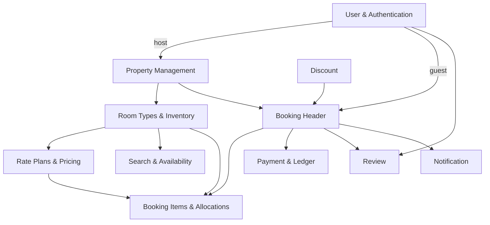

# Domain Overview

**Canonical inventory domain ([PropertyInventoryBusinessRules.md](../business/PropertyInventoryBusinessRules.md)):** Property → RoomTypes → shared-inventory RatePlans; type/date inventory; Booking → Items → per-room allocations/nightly snapshots. Mỗi booking giữ nguyên tắc thuộc về một property/currency/date range nhất định. Kiến trúc này đã được triển khai qua các migration V14 ([V14__add_room_type_inventory_foundation.sql](../../src/main/resources/db/migration/V14__add_room_type_inventory_foundation.sql)) và V16 ([V16__add_inventory_rate_plan_pricing_and_hold_keys.sql](../../src/main/resources/db/migration/V16__add_inventory_rate_plan_pricing_and_hold_keys.sql)). Chi tiết quan hệ các bảng xem tại [3_CoreERD.md](3_CoreERD.md).

## TARGET financial domain — S0-109-v1 FROZEN_DESIGN, implementation pending

[Policy](../business/contracts/s0-policy-v1.json)/[typed API](../business/contracts/s0-api-v1.json) freeze all S0 decisions, sourceCompatibility none. WholeVND/immutable versions+quotehash/20% postdiscount deposit/15% prediscount room+clean commission/platformD/Cnet coverage/noGuestfee; active T6.800.000. 900s/max3/ALLARRIVED+24/allgates/refund source/090 review frozen.

[Payment rules](../business/PaymentBusinessRules.md): FULL_PREPAY và HYBRID_DEPOSIT cùng core MVP; Booking snapshot mode/dueOnline/direct balance/policy/commission/funding. Nhiều online PaymentAttempts (provider-verified), direct Host-attested receipts/reversals, actual per-room CheckInEvents, balanced ledger/refunds/payout/disputes là domain riêng theo [3_CoreERD.md](3_CoreERD.md). Instant confirm sau đủ online + active hold, không chờ direct balance. Commission due/reserved/earned khác nhau; payout chỉ eligible actual check-in+24h có gates.

## Main relationships

- A **User** can act as `GUEST`, `HOST`, or `ADMIN`.
- A **Host** owns multiple **Properties**.
- A **Property** has a `sale_mode` (`WHOLE_PLACE` or `ROOM_BASED`), multiple **PropertyImages**, and belongs to many **Amenities**.
- A **Property** owns one or more **RoomTypes** (vd: Deluxe, Family Suite, hoặc 1 loại phòng đại diện nguyên căn đối với `WHOLE_PLACE`).
- Each **RoomType** has a base physical quantity, guest capacity, daily stock calendar (`type_day_inventory`), and offers multiple **RatePlans** (gói giá linh hoạt) chia sẻ chung quỹ phòng.
- A **Guest** can create multiple **Bookings**.
- Each **Booking** contains one or more **BookingItems** (chọn `RoomType`, `RatePlan` và số lượng phòng `quantity`).
- Each **BookingItem** defines **RoomAllocations** (người lớn, trẻ em từng phòng) và **NightlySnapshots** (lưu giá và phụ phí từng đêm).
- A **Booking** can optionally apply one **DiscountCode** và hỗ trợ Dual Payment Modes (`FULL_PREPAY` 100% online vs `HYBRID_DEPOSIT` 20% cọc online + 80% tại chỗ nhận phòng).
- A completed **Booking** with verified stay evidence can have at most one **Review**.
