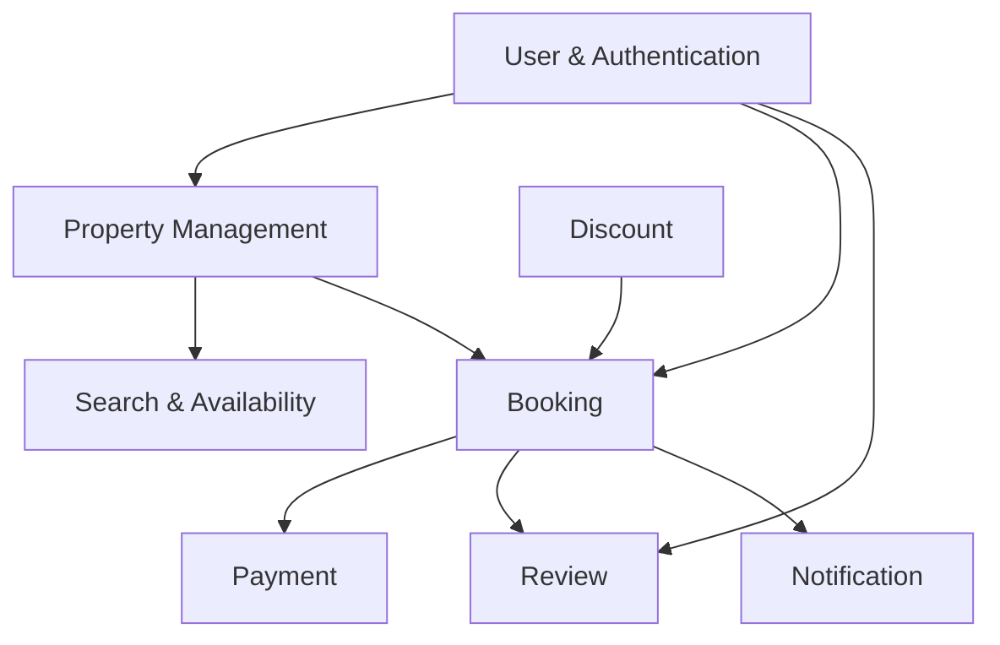

> **CURRENT/LEGACY conceptual overview, không phải TARGET đã triển khai.** [Canonical target](../business/PropertyInventoryBusinessRules.md): Property → RoomTypes → shared-inventory RatePlans; type/date inventory; Booking → Items → per-room allocations/nightly snapshots. Một booking vẫn một property/currency/date range. Mọi delta cần TSK-097–108 và reconciliation trước release.

## TARGET financial domain — S0-109-v1 FROZEN_DESIGN, implementation pending

[Policy](../business/contracts/s0-policy-v1.json)/[typed API](../business/contracts/s0-api-v1.json) freeze allS0 decisions, sourceCompatibility none. WholeVND/immutableversions+quotehash/20%postdiscountdeposit/15%prediscountroom+cleancommission/platformD/Cnetcoverage/noGuestfee; activeT6.800.000 not oldfeeexample.900s/max3/ALLARRIVED+24/allgates/refundsource/090review frozen; actualcontracts/tax/provider/calendar/signedops/liquidity/runtime095 BLOCKED. No schemaexisting claim.

[Payment rules](../business/PaymentBusinessRules.md): FULL_PREPAY và HYBRID_DEPOSIT cùng core MVP; Booking snapshot mode/dueOnline/direct balance/policy/commission/funding. Nhiều online PaymentAttempts (provider-verified), direct Host-attested receipts/reversals, actual per-room CheckInEvents, balanced ledger/refunds/payout/disputes là domain riêng theo [ERD](3_CoreERD.md). Instant confirm sau đủ online +active hold, không chờ direct balance. Commission due/reserved/earned khác nhau; payout chỉ eligible actual check-in+24h có gates. One-payment relationship bên dưới chỉ legacy.

## Main relationships

- A **User** can act as `GUEST`, `HOST`, or `ADMIN`.
- A **Host** owns multiple **Properties**.
- A **Property** contains multiple **PropertyImages**.
- A **Property** has many **Amenities** through `property_amenities`.
- A **Guest** can create multiple **Bookings**.
- A **Property** can receive multiple **Bookings** over time.
- A **Booking** can optionally apply one **DiscountCode** and stores discount snapshots.
- A **Booking** has one payment record in the MVP/VNPay flow.
- A completed **Booking** can have at most one **Review**.
