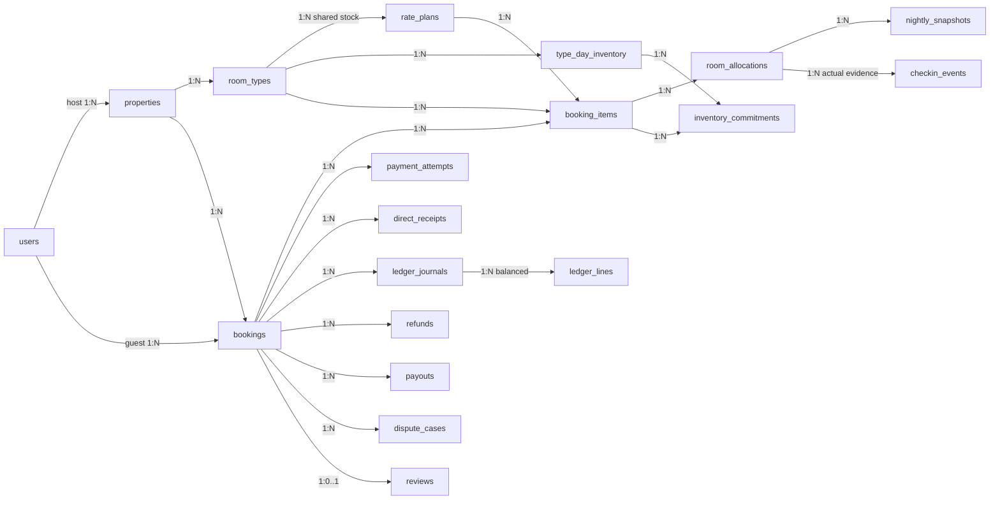
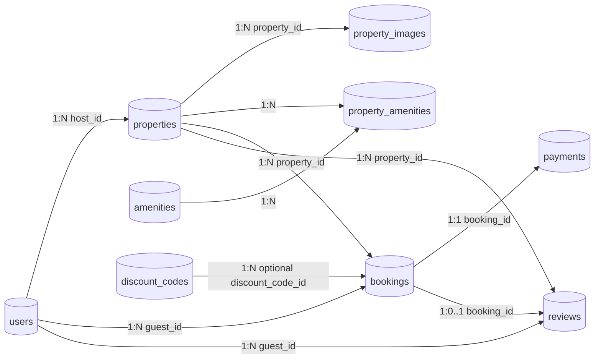

# Relational projections

## TARGET — proposed, chưa migration

Cardinalities cho draft có thể 0 children; submit phải >=1 item. [CoreERD](3_CoreERD.md) và [Payment v2](8_Payment.md) giữ keys/atomicity: nhiều online attempts, unique event/ref/journal, versioned Host-attested direct receipts/reversals, per-room actual check-in, balanced ledger/refund/payout/disputes. Booking snapshot mode/required online/direct split/policy/funding; zero-online exception phải duyệt, không bypass hybrid deposit. Both modes core MVP; legacy1:1 bên dưới không còn là target.

## CURRENT/LEGACY conceptual archive — không phải target

