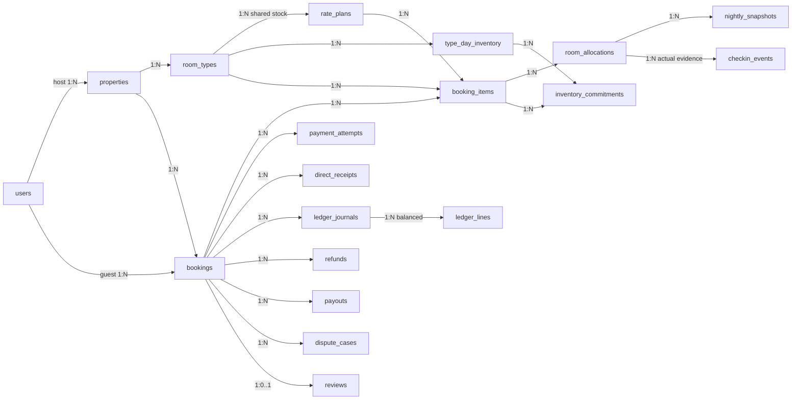
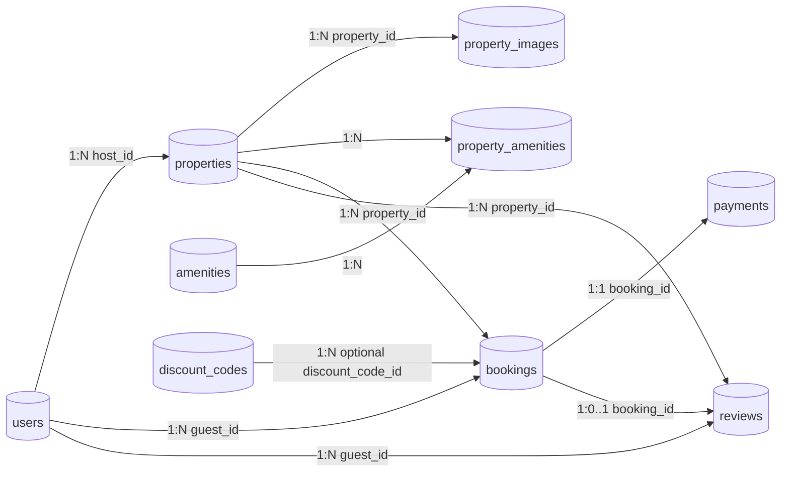

# Relational projections

**V14 actual additive subset (independently accepted TSK-099):** property/type/plan/day/item/allocation/
nightly/commitment links now have actual migrations ([V14__add_room_type_inventory_foundation.sql](../../src/main/resources/db/migration/V14__add_room_type_inventory_foundation.sql) and [V16__add_inventory_rate_plan_pricing_and_hold_keys.sql](../../src/main/resources/db/migration/V16__add_inventory_rate_plan_pricing_and_hold_keys.sql)) and capacity primitives; [manifest and limitations](../tasklist/evidence/TSK-099.md). Sơ đồ thực thể chi tiết xem tại [3_CoreERD.md](3_CoreERD.md).

## Active Relational Schema (Multi-Room & Dual-Payment)

**S0-109-v1 FROZEN_DESIGN** [typed contract](../business/contracts/s0-api-v1.json): draft0children/submit>=1item; ERD/Payment keys/atomicity multipleattempts/uniqueevent/journal/directmemo/perroomactual/balancedledger. Immutable policyVersion/fixtureVersion/quoteHash/snapshots, wholeVND/noGuestfee/platformD/O>=Cnet, zeroT/O rejected/no exception. Original900s/max3, ALLARRIVED+24/allgates and review090 frozen; no migration/runtime/legal claim. Legacy1:1 below archive.

## CURRENT/LEGACY conceptual archive — không phải target

