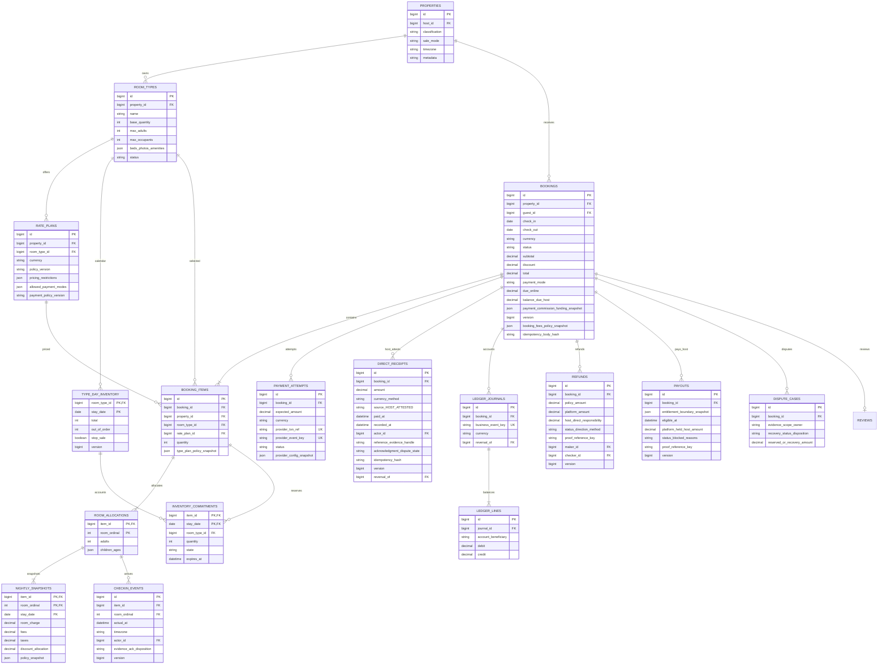
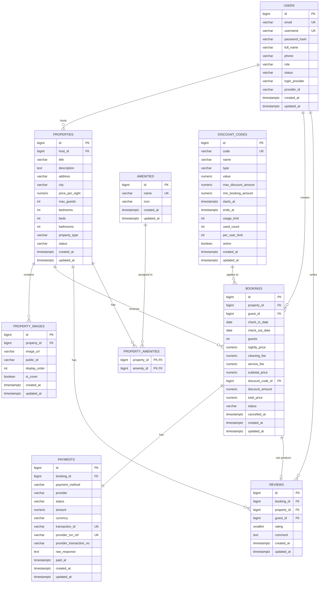

# Core ERD

## V14 actual additive subset — independently accepted TSK-099

TSK-099 adds the seven inventory tables shown below, nullable legacy sale_mode,
HCM timezone, composite FKs, deferred graph-shape checks and DB capacity triggers.
See [exact schema/lock/test/rollback evidence](../tasklist/evidence/TSK-099.md).
Classification maps to existing `properties.property_type` (not a new column).
Money uses an exact NUMERIC domain with whole/range checks to reject fractions
before SQL typmod rounding. Whole-place type identity is conservatively unique
even after archive (same identity can reactivate). Type scope, item selection and
nightly snapshots are immutable; snapshot DELETE-and-replace is forbidden.
Current occupancy limits remain editable: items capture immutable max-adults /
max-occupants rights; new admission checks current limits under type/plan SHARE
locks, while existing holds can convert/release after archive or limit changes.
Capacity primitives exist, but no checkout cutover/backfill is implied.
The property-wide legacy exclusion remains. Financial/evidence records and extra
header fields below are still TARGET, **not** implemented by V14. Independent
review accepted the corrected foundation and rollback design on2026-10-23;
TSK-099 is complete only for this subset. Backfill/cutover remain blocked.

## TARGET — conceptual fields, chưa có schema/migration

Theo [canonical](../business/PropertyInventoryBusinessRules.md); names dưới là đề xuất DB review TSK-099, không map tự động sang entity hiện tại. `type_day_inventory` là tên thống nhất cho type/date inventory (canonical từng gọi `type_date_inventory`).

**S0-109-v1 FROZEN_DESIGN:** [API field authority](../business/contracts/s0-api-v1.json), [policy](../business/contracts/s0-policy-v1.json). Conceptual DB decimal Money below must have integer wholeVND/scale0 constraints in099, no float; DB snake_case maps APIcamelCase. Required immutable policy_version/fixture_version/quote_hash/actor+consent+selection+amount snapshot, quote_expires_at distinct hold_expires_at(originalcreated+900s), max3 ordinal records/deduped credit. Active room7m/D200k/T6.8m/Cgross1.05m/Cnet850k/hybridO1.36m/B5.44m/held510k/fullheld5.95m; no Guestfee, funded expense separate grossdue. Real-money095 blocked, no schema/migration runtime claim.

**Approved domain S0-097-v1 (2026-10-23):** exclusive WHOLE_PLACE/ROOM_BASED, no linked whole+room sale; RoomType pools only truly interchangeable rooms, all RatePlans share type stock. Whole-place has one type quantity1; bedrooms are descriptive. Booking header fixes one property/date range/VND for every item; cancellation releases the whole booking, never selected item/quantity. PhysicalRoom assignment is future scope. These are approved design constraints, not optional schema assumptions; TSK-099 must implement/review actual cross-row protections and TSK-106 backfill must preserve evidence, not fabricate historical sale modes. [Approval log](../business/S0DecisionLog.md).

**Payment TARGET:** conceptual fields not exhaustive migrations; [Payment data](8_Payment.md) source/direction/method/timestamps/key/proof/makerchecker/privateevidence. Manyattempts/directmemo not platformcash, events allocation(item,ordinal), balanced journals/uniqueness/immutable reversals, commissionreserve not earned. Refund sourcepolicy/cash/paid/reserved/liquidity locks. ALLARRIVED maxactual+24/allgates and evidence090 frozen, not scheduledtransfer/perroom earlypayout. Bothmodes MVP, no monthlycommission; legacy1:1 below archive.

**Accounting choisi:** commitments là nguồn chuẩn duy nhất, mỗi item/night một row `HELD/CONFIRMED/RELEASED`, không có counters held/confirmed độc lập. Sum active HELD và CONFIRMED dưới khóa day row. Expired hold chỉ được bỏ khỏi sum sau transition RELEASED serialized; trước khi bán phải release expired trong transaction. `blocked = out_of_order`; stop-sale là sales restriction (không xóa commitments), không trừ cả total lần nữa. `remaining = total - out_of_order - held - confirmed`; `availableQuantity = 0` khi stop-sale, ngược lại min remaining toàn stay. Stop-sale chặn bán mới, OOO giảm capacity; cả hai không hủy booking/hold cũ.

**Integrity đề xuất:** UNIQUE(type_id, property_id), UNIQUE(plan_id, type_id, property_id), composite FK item→booking(id,property_id), item→type và plan cùng property/type; commitment→item(id,type_id) và day(type_id,date); snapshot→allocation(item_id,ordinal). Quantity>0, checkIn<checkOut; ordinal count=quantity, dates chính xác mọi đêm. Ràng buộc nhiều row dùng transaction/constraint trigger được DB review, không giả CHECK một row đủ bảo vệ. Monetary precision theo currency; sum nightly + scoped fees − discount = header, snapshot tên và policy không cascade mất khi archive.

**Transaction protocol:** khóa booking/lifecycle row trước (khi đã tồn tại), rồi mọi day row theo `(room_type_id, stay_date)` tăng dần; tạo day rows thiếu bằng unique key trước lock, không coi missing row là unlimited. Capacity update, hold, expiry, IPN, cancel cùng protocol. Create revalidate tất cả selection/caps rồi insert toàn items/commitments hoặc rollback. IPN khóa cùng booking, kiểm expiry và trạng thái, đổi HELD→CONFIRMED trên chính rows trong cùng commit payment, không insert thêm confirmation/decrement stock lần2. Expiry/cancel đổi RELEASED đúng một lần; late paid ghi ledger/refund reconciliation, không hồi sinh. Lock discount caps theo thứ tự toàn cục được review cùng protocol để tránh deadlock. Không có exclusivity theo type toàn booking; nhiều bookings dùng chung pool hợp lệ.

**Rollout:** additive types/plans/day/items/allocation/snapshots; backfill default type quantity1 và plan, giữ IDs, historical unknown có provenance. Không merge theo địa chỉ. Reconcile totals/active future commitments, shadow read/write coordination và capacity protection trước thay exclusion property. Rollback bảo toàn mới phát sinh; chi tiết canonical mục7. Physical rooms không bắt buộc schema này.

**Stop-sale scope:** `TYPE_DAY_INVENTORY.stop_sale` chặn bán mới mọi plan của type/ngày; plan/day stop-sale thuộc `RATE_PLANS.pricing_restrictions`, chỉ chặn plan đó. Offer quantity bằng min remaining toàn stay chỉ khi cả type và plan đủ điều kiện, ngược lại0; remaining không bị reset/trừ bởi stop-sale. Luôn enforce `0 <= out_of_order <= total` và `held + confirmed <= total - out_of_order`, kể cả đóng bán. Không release hoặc ngăn conversion hợp lệ của hold cũ chỉ vì stop-sale mới; mọi plans vẫn dùng cùng pool.

## CURRENT/LEGACY conceptual archive

Các entity/payment/state legacy dưới đây giữ nguyên để đối chiếu, không chứng minh target đã tồn tại.

