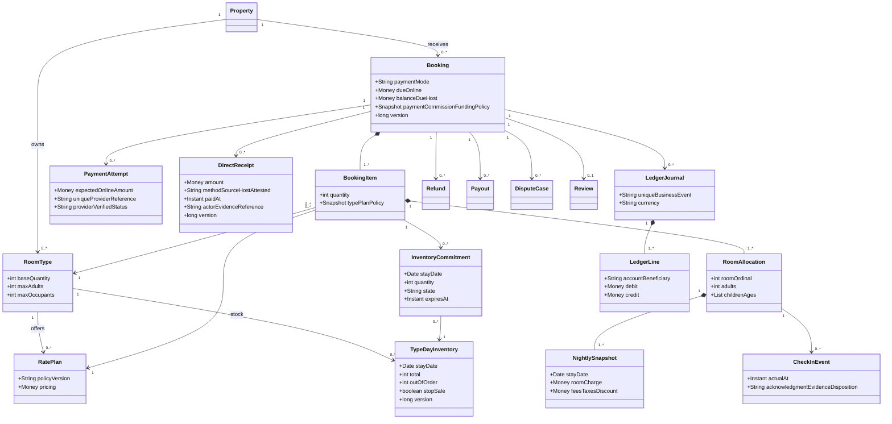
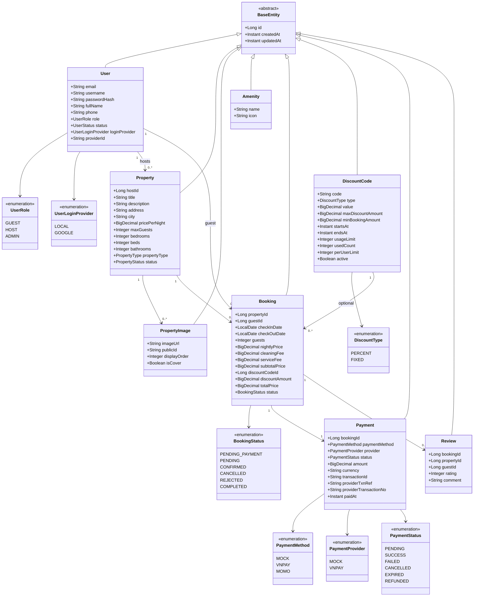

# Domain class projections

## TARGET — conceptual, không phải Java classes đã có

Associations không hàm ý cascade delete; snapshot phải giữ khi archive. Shared stock và protocol giao dịch theo [ERD](3_CoreERD.md), không gọi từng item confirm độc lập. Service boundary target gồm quote/revalidate, reserveAll, convertAll, releaseAll; financial refund riêng cancellation.

Payment v2 boundary: [Payment rules](../business/PaymentBusinessRules.md) / [data fields](8_Payment.md). Cả full/hybrid; reserve commission không phải earned revenue, direct receipt không provider event. Append reversals và balanced journal; refund/payout proof/maker-checker/private evidence/idempotency/version. Eligibility service đọc actual per-room check-in+24h/dispute/reconcile/legal, không calendar hoặc Host tap. Proposed classes không phải file Java hiện hữu.

## CURRENT/LEGACY conceptual archive

