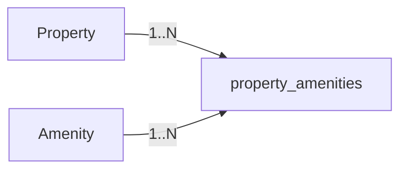

# Properties

**V14 actual additive foundation, independently accepted TSK-099:** nullable `sale_mode`, fixed HCM
`timezone`, explicit-mode room_types, shared-stock rate_plans and type_day_inventory
with DB capacity guards now exist in PostgreSQL migrations ([V14__add_room_type_inventory_foundation.sql](../../src/main/resources/db/migration/V14__add_room_type_inventory_foundation.sql) and [V16__add_inventory_rate_plan_pricing_and_hold_keys.sql](../../src/main/resources/db/migration/V16__add_inventory_rate_plan_pricing_and_hold_keys.sql)). Existing `property_type` is classification.
Whole-place type identity remains unique including archive; same-identity
reactivation is allowed. Current max_adults/max_occupants/base_quantity are editable
with DB checks; booking items capture occupancy rights, so changes cannot rewrite
history. New holds serialize with status/occupancy UPDATE using FOR SHARE, not
FOR KEY SHARE. Day total/OOO changes still cannot break existing commitments.
[Exact limitations/evidence](../tasklist/evidence/TSK-099.md).

**S0-109-v1 FROZEN_DESIGN** [policy](../business/contracts/s0-policy-v1.json)/[API](../business/contracts/s0-api-v1.json): exclusive WHOLE_PLACE/ROOM_BASED/interchangeable pool/shared plans/wholeplace1/descriptive bedrooms approved. Plan policyVersion/allowedmodes snapshot, Money wholeVND/noGuestfee/O>=Cnet, HCM090 time/occupancy. Canonical domain rules defined at [PropertyInventoryBusinessRules.md](../business/PropertyInventoryBusinessRules.md) and full entity relationship at [3_CoreERD.md](3_CoreERD.md).

**TARGET payment v2:** RatePlan allowedPaymentModes/paymentPolicyVersion server-validated; selected mode frozen tại quote/booking, không sinh stock riêng. Full và hybrid bắt buộc trong release MVP; invalid coverage offer bị reject/requote chứ không đẩy hybrid sang later. Actual check-in theo booking room allocation, không cần PhysicalRoom schema; payout gate không lấy ngày property calendar làm evidence. Xem [Payment rules](../business/PaymentBusinessRules.md).

---

## 1. Properties Table

Bảng `properties` đóng vai trò là thực thể cơ sở lưu trú (Listing / Facility aggregation), chứa thông tin địa điểm, phân loại hình thức bán (`sale_mode`), múi giờ và thông tin giới thiệu chung. Đối với cơ sở nhiều phòng (`ROOM_BASED`), giá bán và sức chứa được cấu hình cụ thể theo từng `room_types` và `rate_plans`.

| Column | Type | Constraint | Description |
|---|---|---|---|
| `id` | BIGINT | PK | Property identifier |
| `host_id` | BIGINT | FK → users.id | Owner/host |
| `title` | VARCHAR(255) | NOT NULL | Property title |
| `description` | TEXT | NOT NULL | Description |
| `address` | VARCHAR(500) | NOT NULL | Address |
| `city` | VARCHAR(100) | NOT NULL | Searchable city |
| `sale_mode` | VARCHAR(20) | CHECK IN ('WHOLE_PLACE','ROOM_BASED') | Chế độ kinh doanh: nguyên căn hoặc từng phòng |
| `timezone` | VARCHAR(40) | NOT NULL, DEFAULT 'Asia/Ho_Chi_Minh' | Múi giờ vận hành chuẩn |
| `property_type` | VARCHAR(30) | NOT NULL | Property classification (APARTMENT, VILLA, HOTEL_ROOM...) |
| `status` | VARCHAR(20) | NOT NULL | Listing state (`ACTIVE`, `INACTIVE`, `DRAFT`) |
| `rating_avg` | NUMERIC(3,2) | NOT NULL, DEFAULT 0 | Điểm đánh giá trung bình tích lũy |
| `price_per_night` | NUMERIC(12,2) | NOT NULL | Giá tham khảo ban đầu (legacy/indicative) |
| `cleaning_fee` | NUMERIC(12,2) | NOT NULL, DEFAULT 0 | Phí dọn dẹp cơ sở |
| `max_guests` | INT | NOT NULL | Sức chứa tham khảo toàn cơ sở |
| `bedrooms` | INT | NOT NULL | Số phòng ngủ tham khảo |
| `beds` | INT | NOT NULL | Số giường tham khảo |
| `bathrooms` | INT | NOT NULL | Số phòng tắm tham khảo |
| `created_at` | TIMESTAMPTZ | NOT NULL | Creation timestamp |
| `updated_at` | TIMESTAMPTZ | NOT NULL | Last update timestamp |

---

## 2. Room Types Table (`room_types`)

Mỗi Property sở hữu **1 hoặc nhiều Room Types** (hạng phòng bán được).
- Nếu `sale_mode = 'ROOM_BASED'`: Property có nhiều hạng phòng (ví dụ Deluxe, Standard, Family), mỗi loại có số lượng phòng thực tế (`base_quantity > 0`) và giới hạn sức chứa độc lập.
- Nếu `sale_mode = 'WHOLE_PLACE'`: Property có đúng **1 room_type duy nhất** đại diện cho toàn bộ căn hộ/villa với `base_quantity = 1`.

| Column | Type | Constraint | Description |
|---|---|---|---|
| `id` | BIGSERIAL | PK | Room type identifier |
| `property_id` | BIGINT | FK → properties.id, NOT NULL | Chỗ ở sở hữu hạng phòng |
| `sale_mode` | VARCHAR(20) | NOT NULL, CHECK IN ('WHOLE_PLACE','ROOM_BASED') | Chế độ bán khớp với property |
| `name` | VARCHAR(255) | NOT NULL | Tên hạng phòng (vd: Deluxe Ocean View, Family Suite) |
| `base_quantity` | INT | NOT NULL, CHECK (base_quantity > 0) | Tổng số lượng phòng vật lý thuộc loại này |
| `max_adults` | INT | NOT NULL, CHECK (max_adults >= 1) | Số người lớn tối đa cho 1 phòng |
| `max_occupants` | INT | NOT NULL, CHECK (max_occupants >= max_adults) | Tổng số khách tối đa (người lớn + trẻ em) |
| `status` | VARCHAR(20) | NOT NULL, DEFAULT 'ACTIVE' | Trạng thái (`ACTIVE`, `ARCHIVED`) |
| `metadata` | JSONB | NOT NULL, DEFAULT '{}' | Thuộc tính mở rộng, tiện ích phòng, danh sách ảnh |
| `version` | BIGINT | NOT NULL, DEFAULT 0 | Optimistic locking version |

---

## 3. Rate Plans Table (`rate_plans`)

Mỗi `room_type` cung cấp **1 hoặc nhiều Rate Plans** (gói giá và chính sách bán). Mọi Rate Plan thuộc cùng một `room_type` đều **chia sẻ chung quỹ phòng vật lý** (`type_day_inventory`).

| Column | Type | Constraint | Description |
|---|---|---|---|
| `id` | BIGSERIAL | PK | Rate plan identifier |
| `property_id` | BIGINT | FK → properties.id, NOT NULL | Chỗ ở sở hữu |
| `room_type_id` | BIGINT | FK → room_types.id, NOT NULL | Hạng phòng áp dụng gói giá |
| `name` | VARCHAR(255) | NOT NULL | Tên gói giá (vd: Tiêu chuẩn linh hoạt, Giá ưu đãi không hoàn tiền) |
| `currency` | VARCHAR(3) | NOT NULL, DEFAULT 'VND' | Đơn vị tiền tệ (VND) |
| `policy_version` | VARCHAR(100) | NOT NULL | Phiên bản chính sách hoàn hủy áp dụng |
| `nightly_price` | NUMERIC(12,2) | NULLABLE (được set bởi Host) | Giá bán một đêm chuẩn (whole VND) |
| `allowed_payment_modes` | JSONB | NOT NULL | Mảng chế độ thanh toán cho phép (`FULL_PREPAY`, `HYBRID_DEPOSIT`) |
| `pricing_restrictions` | JSONB | NOT NULL, DEFAULT '{}' | Điều kiện áp dụng giá (yêu cầu số đêm tối thiểu, v.v.) |
| `status` | VARCHAR(20) | NOT NULL, DEFAULT 'ACTIVE' | Trạng thái gói giá (`ACTIVE`, `ARCHIVED`) |
| `version` | BIGINT | NOT NULL, DEFAULT 0 | Optimistic locking version |

---

## 4. Type Day Inventory Table (`type_day_inventory`)

Quản lý số lượng phòng trống và trạng thái mở bán theo từng ngày lưu trú (`stay_date`) cho mỗi `room_type`.

| Column | Type | Constraint | Description |
|---|---|---|---|
| `room_type_id` | BIGINT | PK, FK → room_types.id | Hạng phòng |
| `stay_date` | DATE | PK | Ngày lưu trú |
| `total` | INT | NOT NULL, CHECK (total >= 0) | Tổng số phòng vật lý khả dụng trong ngày |
| `out_of_order` | INT | NOT NULL, DEFAULT 0 | Số phòng bị hỏng/bảo trì (0 <= OOO <= total) |
| `stop_sale` | BOOLEAN | NOT NULL, DEFAULT false | Cờ đóng bán cưỡng bức bởi Host |
| `version` | BIGINT | NOT NULL, DEFAULT 0 | Optimistic locking version |

---

## 5. Relationship Diagram

```text
users (HOST)
       1
       │
       │ owns
       ▼
properties ─────── 1 : N ─────── room_types
   ├── 1 : N property_images         ├── 1 : N rate_plans (shared stock)
   ├── N : M property_amenities      └── 1 : N type_day_inventory (daily stock)
   ├── 1 : N bookings
   └── 1 : N reviews
```

---

## 6. Property Images (`property_images`)

| Column | Type | Constraint | Description |
|---|---|---|---|
| `id` | BIGINT | PK | Image identifier |
| `property_id` | BIGINT | FK → properties.id | Related property |
| `image_url` | VARCHAR(1000) | NOT NULL | Image URL |
| `public_id` | VARCHAR(255) | NULL | Cloudinary/local storage identifier |
| `display_order` | INT | NOT NULL | Gallery order |
| `is_cover` | BOOLEAN | NOT NULL | Cover image flag |
| `created_at` | TIMESTAMPTZ | NOT NULL | Creation timestamp |
| `updated_at` | TIMESTAMPTZ | NOT NULL | Last update timestamp |

Quy tắc: Mỗi cơ sở có tối đa một ảnh đại diện (`is_cover = true`). Chỉ số `display_order` là duy nhất trong từng cơ sở.

---

## 7. Property Amenities (`property_amenities`)

Bảng nối quan hệ nhiều-nhiều giữa chỗ ở và tiện nghi cơ sở.

| Column | Type | Constraint |
|---|---|---|
| `property_id` | BIGINT | PK, FK → properties.id |
| `amenity_id` | BIGINT | PK, FK → amenities.id |


