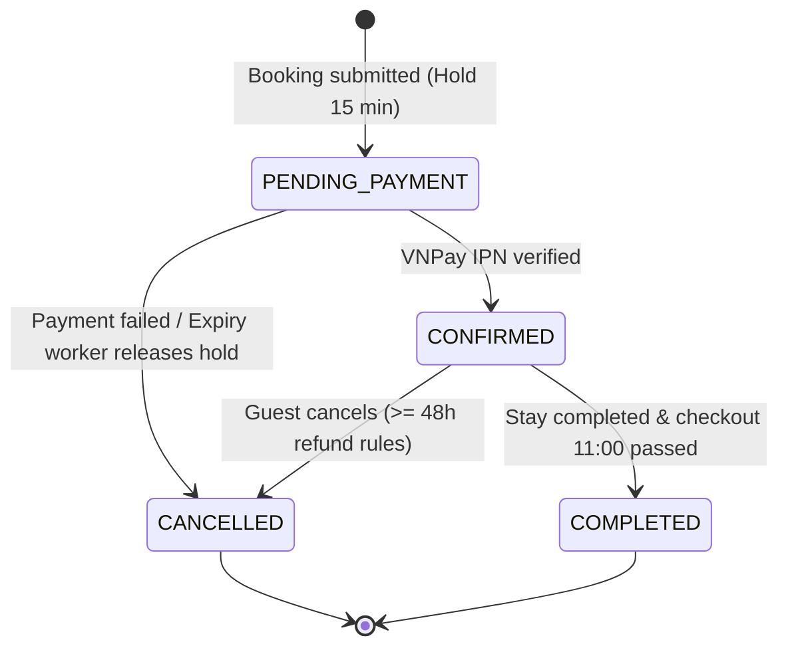

# Bookings

**V14 actual additive subset (independently accepted TSK-099):** booking_items, room_allocations,
nightly_snapshots, inventory_commitments plus internal transactional capacity
primitives in PostgreSQL migration ([V14__add_room_type_inventory_foundation.sql](../../src/main/resources/db/migration/V14__add_room_type_inventory_foundation.sql)); [schema/tests/rollback](../tasklist/evidence/TSK-099.md). Composite
references and deferred shape guards do not replace checkout/lifecycle/financial
validation. Legacy active property exclusion is preserved.

**V16 Sprint 2 implementation (scoped task acceptance):** inventory holds use
server-configured whole-VND rate-plan nightly prices; the internal booking core
persists currency/payment-mode/policy/idempotency/deadline metadata and item,
room-allocation, and per-night snapshots atomically with every inventory hold.
Retries with same actor/key/body replay the same booking; changed body conflicts.
Cancel/expiry releases the full booking hold. Quote consent, payment attempts,
FULL/HYBRID due allocation, IPN confirmation, and a public booking-create endpoint
are implemented and verified ([TSK-103](../tasklist/evidence/TSK-103.md), [TSK-082](../tasklist/evidence/TSK-082.md)).

> **S0-109-v1 FROZEN_DESIGN**, source compatibility none: [policy](../business/contracts/s0-policy-v1.json)/[typed API](../business/contracts/s0-api-v1.json). Header oneproperty/date/VND, wholebookingcancel approved, sharedplanstock/all-itematomicity. Store policyVersion/fixtureVersion/quoteHash/consent/selection/amount/actor immutable; quoteExpiresAt distinct originalcreated+900s hold/max3. Money wholeVND, no Guestfee, platformD/Cnet coverage, active6.800.000 fixture. Xem [Payment rules](../business/PaymentBusinessRules.md) và [Core ERD](3_CoreERD.md).

---

## 1. Bookings Header Table (`bookings`)

Bảng `bookings` lưu trữ thông tin cấp cao (header) của một đơn đặt phòng: khách đặt, cơ sở lưu trú, khoảng ngày lưu trú, chế độ thanh toán (Dual Mode), các mốc thời gian giữ chỗ (hold) và tổng hợp tài chính.

| Column | Type | Constraint | Description |
|---|---|---|---|
| `id` | BIGINT | PK | Booking identifier |
| `property_id` | BIGINT | FK → properties.id, NOT NULL | Booked property |
| `guest_id` | BIGINT | FK → users.id, NOT NULL | Khách thực hiện đặt phòng |
| `check_in_date` | DATE | NOT NULL | Ngày nhận phòng (14:00 HCM) |
| `check_out_date` | DATE | NOT NULL | Ngày trả phòng (11:00 HCM) |
| `status` | VARCHAR(20) | NOT NULL | `PENDING_PAYMENT`, `CONFIRMED`, `CANCELLED`, `COMPLETED` |
| `payment_mode` | VARCHAR(20) | NOT NULL, DEFAULT 'FULL_PREPAY' | `FULL_PREPAY` (100% online) hoặc `HYBRID_DEPOSIT` (20% cọc) |
| `currency` | VARCHAR(3) | NOT NULL, DEFAULT 'VND' | Tiền tệ giao dịch (VND) |
| `subtotal_price` | NUMERIC(12,2) | NOT NULL | Tổng tiền phòng + phí dịch vụ trước giảm giá |
| `discount_code_id` | BIGINT | FK → discount_codes.id, NULLABLE | Mã giảm giá được áp dụng |
| `discount_amount` | NUMERIC(12,2) | NOT NULL, DEFAULT 0 | Số tiền được giảm giá |
| `total_price` | NUMERIC(12,2) | NOT NULL | Tổng giá trị toàn đợt lưu trú ($T = \text{subtotal} - \text{discount}$) |
| `due_online` | NUMERIC(12,2) | NOT NULL | Số tiền phải thanh toán online qua VNPay |
| `balance_due_host` | NUMERIC(12,2) | NOT NULL, DEFAULT 0 | Số dư trả trực tiếp cho Host tại lúc check-in |
| `inventory_hold_expires_at` | TIMESTAMPTZ | NULLABLE | Hạn chót giữ chỗ tạm thời (createdAt + 15 phút) |
| `inventory_idempotency_key` | VARCHAR(100) | NULLABLE | Khóa chống trùng lặp tạo đơn |
| `cancelled_at` | TIMESTAMPTZ | NULLABLE | Thời điểm hủy đặt phòng |
| `created_at` | TIMESTAMPTZ | NOT NULL | Creation timestamp |
| `updated_at` | TIMESTAMPTZ | NOT NULL | Last update timestamp |

---

## 2. Booking Items Table (`booking_items`)

Mỗi đơn đặt phòng bao gồm **1 hoặc nhiều Booking Items**. Mỗi item đại diện cho một lựa chọn hạng phòng (`room_type_id`) và gói giá (`rate_plan_id`) cùng với số lượng phòng đặt (`quantity`).

| Column | Type | Constraint | Description |
|---|---|---|---|
| `id` | BIGSERIAL | PK | Item identifier |
| `booking_id` | BIGINT | FK → bookings.id, NOT NULL | Đơn đặt phòng cha |
| `property_id` | BIGINT | FK → properties.id, NOT NULL | Cơ sở lưu trú |
| `room_type_id` | BIGINT | FK → room_types.id, NOT NULL | Hạng phòng được chọn |
| `rate_plan_id` | BIGINT | FK → rate_plans.id, NOT NULL | Gói giá được chọn |
| `quantity` | INT | NOT NULL, CHECK (quantity > 0) | Số lượng phòng thuộc hạng này |
| `type_plan_policy_snapshot` | JSONB | NOT NULL, DEFAULT '{}' | Snapshot bất biến chính sách của hạng phòng & gói giá |

---

## 3. Room Allocations Table (`room_allocations`)

Lưu chi tiết phân bổ khách cho từng phòng vật lý trong item (ví dụ: Item đặt 2 phòng Deluxe thì sẽ có 2 allocations với `room_ordinal = 1` và `room_ordinal = 2`).

| Column | Type | Constraint | Description |
|---|---|---|---|
| `item_id` | BIGINT | PK, FK → booking_items.id | Booking item cha |
| `room_ordinal` | INT | PK, CHECK (room_ordinal >= 1) | Thứ tự phòng trong item (1, 2, ...) |
| `adults` | INT | NOT NULL, CHECK (adults >= 1) | Số người lớn được phân bổ |
| `children_ages` | JSONB | NOT NULL, DEFAULT '[]' | Danh sách độ tuổi trẻ em đi kèm |

---

## 4. Nightly Snapshots Table (`nightly_snapshots`)

Lưu snapshot giá, phụ phí và phân bổ giảm giá cho từng đêm lưu trú của từng phòng. Đảm bảo lịch sử giá không bị thay đổi khi Host chỉnh sửa giá phòng trong tương lai.

| Column | Type | Constraint | Description |
|---|---|---|---|
| `item_id` | BIGINT | PK, FK → booking_items.id | Booking item |
| `room_ordinal` | INT | PK | Thứ tự phòng |
| `stay_date` | DATE | PK | Ngày lưu trú |
| `room_charge` | NUMERIC(12,2) | NOT NULL | Tiền phòng của đêm |
| `fees` | NUMERIC(12,2) | NOT NULL, DEFAULT 0 | Phí dọn dẹp hoặc phụ phí phân bổ |
| `taxes` | NUMERIC(12,2) | NOT NULL, DEFAULT 0 | Thuế phân bổ |
| `discount_allocation` | NUMERIC(12,2) | NOT NULL, DEFAULT 0 | Mức giảm giá phân bổ cho đêm này |
| `policy_snapshot` | JSONB | NOT NULL, DEFAULT '{}' | Snapshot điều kiện giá của đêm |

---

## 5. Inventory Commitments Table (`inventory_commitments`)

Ghi nhận cam kết giữ chỗ hoặc xác nhận giữ phòng trên bảng tồn kho `type_day_inventory`.

| Column | Type | Constraint | Description |
|---|---|---|---|
| `item_id` | BIGINT | PK, FK → booking_items.id | Booking item |
| `stay_date` | DATE | PK | Ngày lưu trú được cam kết giữ phòng |
| `room_type_id` | BIGINT | FK → room_types.id, NOT NULL | Hạng phòng |
| `quantity` | INT | NOT NULL, CHECK (quantity > 0) | Số lượng phòng cam kết |
| `state` | VARCHAR(20) | NOT NULL | Trạng thái: `HELD`, `CONFIRMED`, `RELEASED` |
| `expires_at` | TIMESTAMPTZ | NULLABLE | Thời điểm hết hạn giữ chỗ |

---

## 6. Structure Diagram

```text
bookings (Header)
   │
   └── 1 : N ── booking_items (RoomType + RatePlan selection)
                    ├── 1 : N ── room_allocations (Guest breakdown per room)
                    │               └── 1 : N ── nightly_snapshots (Per-night price snapshots)
                    └── 1 : N ── inventory_commitments (Daily inventory holds)
```

---

## 7. State Transition Matrix



| Current Status | Action / Event | Next Status | Business Condition |
|---|---|---|---|
| `PENDING_PAYMENT` | VNPay xác nhận thanh toán qua IPN | `CONFIRMED` | Khách thanh toán đủ `dueOnline` trong thời hạn hold |
| `PENDING_PAYMENT` | Hết hạn 15 phút hoặc giao dịch thất bại | `CANCELLED` | Release toàn bộ `inventory_commitments` về quỹ phòng |
| `CONFIRMED` | Khách yêu cầu hủy đặt phòng | `CANCELLED` | Hủy toàn bộ booking; nếu trước 48h, kích hoạt hoàn tiền |
| `CONFIRMED` | Hoàn thành chuyến đi | `COMPLETED` | Qua mốc 11:00 ngày check-out và có bằng chứng lưu trú |


For example:

```text
COMPLETED → CANCELLED  ❌
CANCELLED → CONFIRMED  ❌
```
