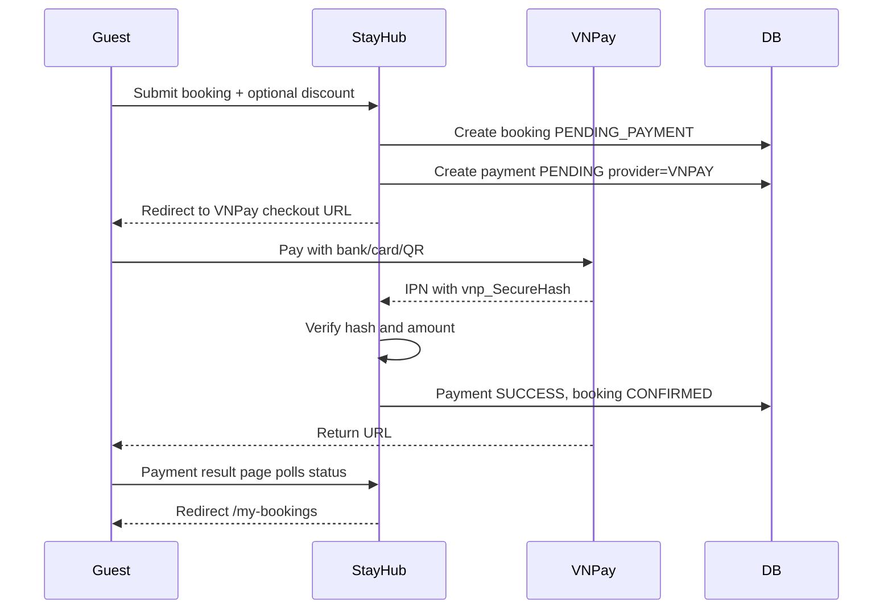

# Payment

## TARGET v2 — cả hai modes bắt buộc, chưa có migration

[Payment canonical](../business/PaymentBusinessRules.md) và [ERD](3_CoreERD.md) có ưu tiên hơn legacy bên dưới. Booking-level settlement có **nhiều attempts**, không giữ UNIQUE booking_id trên attempts. Mode/policy/config/base/rate/rounding/funding/commission snapshots bất biến; full O=T/B0, hybrid required deposit O +direct Host balance B=T. Không dùng booking total để verify gateway hybrid.

| Proposed record | Fields / integrity / source |
|---|---|
| Booking financial snapshot | payment_mode, payment_policy_version, allowed_modes_snapshot, deposit_base/rate/rounding, due_online, balance_due_host, commission_basis/due/earning_rule, funding/fee/tax beneficiaries, currency, version; sums exact, no double legacy service fee |
| PaymentAttempt | id, booking_id, expected_amount (required online), currency, provider/merchant/config snapshot, unique provider_txn_ref, provider_transaction_no/event dedupe, status/received_at, idempotency body hash; many attempts, serialize amount credit; success may be late/extra reconciliation not booking confirmation |
| Collection | booking/attempt nullable ref, direction IN, method VNPAY/CASH/BANK_TRANSFER, amount/currency, source PROVIDER_VERIFIED or HOST_ATTESTED, occurred/recorded_at/actor/version; direct belongs Host, **not platform cash** |
| DirectReceipt + reversal | booking, method CASH/BANK_TRANSFER, amount/currency/paid_at/recorded_at/actor/reference/private evidence handle, acknowledgment/dispute state, idempotency hash/version, original receipt reversal FK; append audit, partial/refused/disputed outstanding tracked |
| CheckInEvent | booking_item_id +room_ordinal FK allocation, actual_at/timezone, actor/evidence handle, guest acknowledgment, contested/admin disposition, version/key; no dependency on PhysicalRoom, no scheduled-date proof |
| LedgerJournal / LedgerLine | journal unique business-event key/reversal_of, booking/currency/policy version; lines account/beneficiary/debit/credit/amount; sum debit=credit **per currency**, immutable; source links collection/refund/payout/funding, private |
| Refund | requested/approved/processing/paid/failed; policy amount vs platform share vs Host direct responsibility; direction OUT, source collection/reservation, amount/currency, maker/checker/reference/proof/timestamps/key/version; reserve pool atomically, no paid from booking CANCELLED alone |
| Payout | entitlement allocation/boundary snapshot, earliest actual check-in+24h, BLOCKED/ELIGIBLE/APPROVED/PROCESSING/PAID/FAILED, holds/dispute/refund/reconcile/legal reasons; manual proof/maker/checker/key/version; amount only platform-held Host entitlement, excludes direct B |
| Dispute / RecoveryCase | room/receipt/entitlement scope, evidence, owner, reserve/clawback/manual recovery, before/after payout, status/disposition; no monthly commission invoice |

Account separation: online cash clearing, commission reserve (not earned), commission revenue when earned, Host payable held, refund reserve/payable, provider costs, tax/fee liabilities and campaign funding expense/credit. Direct receipt memorandum subledger never debits platform cash. Typical illustrative T1m/C150k: full Dr online clearing1m /Cr commission reserve150k /Cr Host payable850k; hybrid Dr online clearing200k /Cr commission reserve150k /Cr Host payable50k; direct800k memo-only. Earn commission via separate reserve→revenue journal when earning rule permits. Reserve is not new revenue. Actual payout reduces payable/cash with proof; reversal/refund uses original allocation, never deletes entries. Fees/costs/funding require separate named balanced lines, not an unexplained balancing plug.

Lock protocol extends booking/lifecycle row → inventory day order → approved global discount/ledger account order; every writer must adopt same reviewed order. Under lock re-evaluate dueOnline outstanding, attempt credit uniqueness, coverage/allocations, refundable remaining/reserves, eligible payable and dispute/legal/liquidity gates. Unique event/journal keys + transactions prevent double credit/refund/payout. Platform `newRefund <= onlineVerified - paidRefunds - reservedRefunds` and policy remaining, with available liquidity check after payout; Host direct responsibility never increases that pool. Adjustments preserve exact header/item/room/night sums and nonnegative entitlements or open deficit recovery case.

Fixture T6.900.000: full online6.900.000/direct0/commission1.035.000/heldHost5.865.000; hybrid fixture20% online1.380.000/direct5.520.000/commission1.035.000/heldHost345.000. Fee100.000 Host, discount200.000 Host-funded, tax/providercost0, commission fixture15% adjusted entitlement; not rollout config. Check-in evidence boundary all-arrived vs per-room and commercial/legal config remain approval gates. Backfill legacy mode/provenance only when supported by evidence; unknown not invented. No SQL/schema/source changed by this design.

## CURRENT/LEGACY archive — not target

> **LEGACY schema/flow proposal; chưa chứng minh implemented canonical.** [TARGET](../business/PropertyInventoryBusinessRules.md): payment tổng booking, không per-item; IPN verified + active all-item holds mới atomic confirm theo flow được PO duyệt. Return/poll read-only; expiry/late paid/duplicates có reconcile/refund riêng. Exact item allocations cộng đúng header, zero-total không gửi gateway sai amount. Refund state độc lập cancellation; funding/payout timing/rates TBD, không mặc định escrow.


| Column | Type | Constraint | Description |
|---|---|---|---|
| `id` | BIGINT | PK | Payment identifier |
| `booking_id` | BIGINT | FK, UNIQUE | Related booking |
| `payment_method` | VARCHAR(20) | NOT NULL | `MOCK`, `VNPAY`, `MOMO` |
| `provider` | VARCHAR(20) | NOT NULL | Payment provider, initially `MOCK` or `VNPAY` |
| `status` | VARCHAR(20) | NOT NULL | Payment state |
| `amount` | NUMERIC(12,2) | NOT NULL | Payment amount |
| `currency` | VARCHAR(3) | NOT NULL | `VND` |
| `transaction_id` | VARCHAR(255) | UNIQUE | Legacy/internal transaction reference |
| `provider_txn_ref` | VARCHAR(100) | UNIQUE | VNPay `vnp_TxnRef` |
| `provider_transaction_no` | VARCHAR(100) | NULL | VNPay `vnp_TransactionNo` |
| `raw_response` | TEXT | NULL | Raw gateway response for audit/debugging |
| `paid_at` | TIMESTAMPTZ | NULL | Success time |
| `created_at` | TIMESTAMPTZ | NOT NULL | Creation timestamp |
| `updated_at` | TIMESTAMPTZ | NOT NULL | Last update timestamp |

## Payment states

```text
PENDING
SUCCESS
FAILED
CANCELLED
EXPIRED
REFUNDED
```

## VNPay relationship



### Recommended business sequence

```text
1. Validate request
2. Check property availability
3. Calculate subtotal
4. Validate discount again on backend
5. Create booking with PENDING_PAYMENT
6. Create payment with PENDING and provider_txn_ref
7. Redirect to VNPay checkout URL
8. VNPay calls IPN/webhook
9. Verify secure hash and amount
10. If payment SUCCESS:
      payment = SUCCESS
      booking = CONFIRMED
      increment discount usage if applicable
11. Result page polls status and redirects user to /my-bookings
```

## VNPay verification rules

- Treat IPN/webhook as the source of truth; return URL is for user experience only.
- Always verify `vnp_SecureHash` using `VNPAY_HASH_SECRET`.
- Always compare `vnp_Amount / 100` against `payments.amount`.
- Updates must be idempotent because VNPay can retry IPN.
- Never log `VNPAY_HASH_SECRET`.
- Do not mark booking confirmed from frontend-only success URL.
