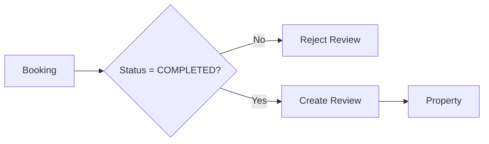

# Reviews

**TARGET payment/check-in v2:** [Payment rules](../business/PaymentBusinessRules.md) tách actual per-room check-in evidence, guarded completion/no-show và financial collection. Host-attested receipt/online SUCCESS/calendar date không tự mở review hay payout; +24h eligibility dựa actual arrival boundary đã duyệt. Một review/eligible booking cho cả full/hybrid, không nhân theo rooms/receipts.

> **TARGET delta chưa triển khai:** [canonical](../business/PropertyInventoryBusinessRules.md) giữ một review/completed booking, aggregate property bất kể quantity/items, optional booked-type context snapshot; không sinh review mỗi phòng. Guard actor/ngày/window theo TSK-090/092, review hai chiều chỉ optional TSK-096. Bảng dưới là baseline, không bằng chứng runtime guard.


| Column | Type | Constraint | Description |
|---|---|---|---|
| `id` | BIGINT | PK | Review identifier |
| `booking_id` | BIGINT | FK, UNIQUE | Source booking |
| `property_id` | BIGINT | FK | Reviewed property |
| `guest_id` | BIGINT | FK | Review author |
| `rating` | SMALLINT | NOT NULL | Rating from 1 to 5 |
| `comment` | TEXT | NULL | Review content |
| `created_at` | TIMESTAMPTZ | NOT NULL | Creation timestamp |
| `updated_at` | TIMESTAMPTZ | NOT NULL | Last update timestamp |

### Review rule

```text
Booking.status must equal COMPLETED
```

before a review can be created.



### Recommended constraints

```sql
CONSTRAINT chk_review_rating
CHECK (rating BETWEEN 1 AND 5);
```

`booking_id UNIQUE` ensures:

```text
One booking → at most one review
```
